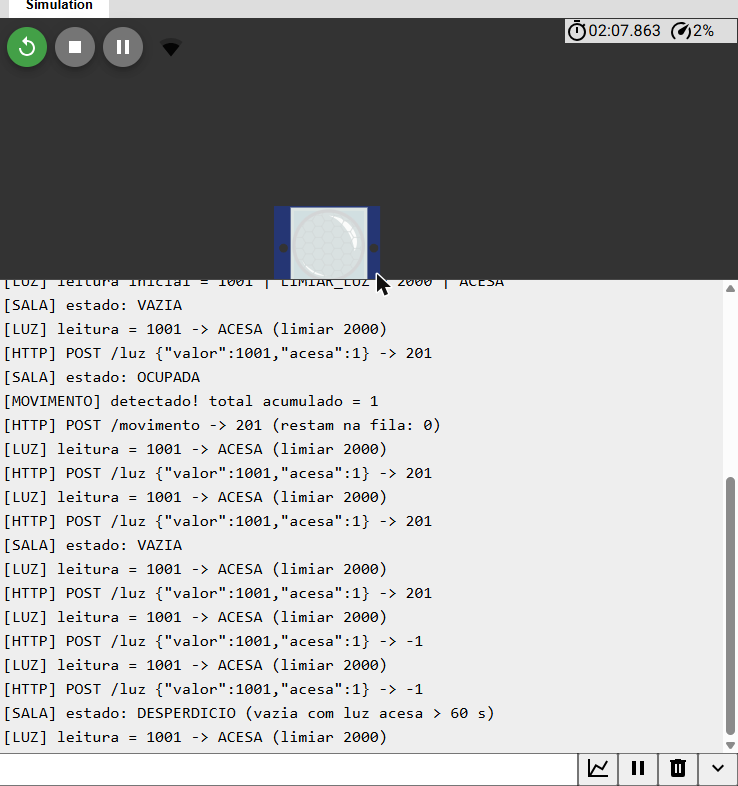
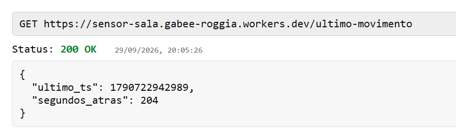
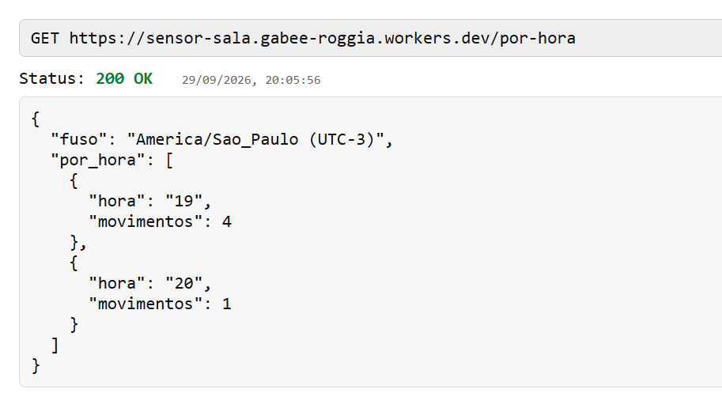
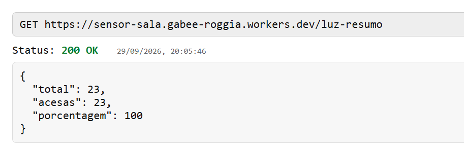
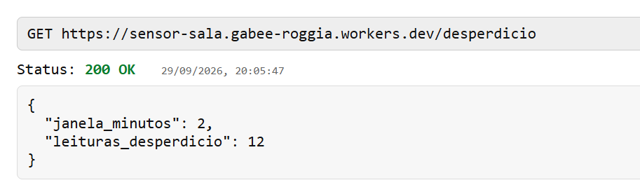

# ENTREGA — Sensor de Sala (IoT)

**Aluno:** Gabriel
**Disciplina:** IoT — Prof. Leonam V. Hemann

## Links

- **URL do Worker:** https://sensor-sala.gabee-roggia.workers.dev
- **Projeto no Wokwi:** https://wokwi.com/projects/476539715096105985
- **Banco D1:** `sensor-sala` (binding `DB` no Worker)

## Endpoints

| Método | Rota | Resposta |
|---|---|---|
| POST | `/movimento` | 201 — grava movimento com `ts = Date.now()` |
| POST | `/luz` | 201 — grava `{ "valor": 3120, "acesa": 1 }` (400 se JSON inválido) |
| GET | `/ultimo-movimento` | 200 — `segundos_atras` (404 se não houver movimentos) |
| GET | `/por-hora` | 200 — movimentos por hora do dia (Brasília) |
| GET | `/luz-resumo` | 200 — total, acesas, porcentagem |
| GET | `/desperdicio` | 200 — leituras com luz acesa sem movimento nos 2 min anteriores |

Rota inexistente → 404; método errado → 405; erro no banco → 500.

## CREATE TABLE

```sql
CREATE TABLE IF NOT EXISTS movimentos (
  id INTEGER PRIMARY KEY AUTOINCREMENT,
  ts INTEGER NOT NULL
);

CREATE TABLE IF NOT EXISTS luz (
  id     INTEGER PRIMARY KEY AUTOINCREMENT,
  valor  INTEGER NOT NULL,
  acesa  INTEGER NOT NULL,
  ts     INTEGER NOT NULL
);

CREATE INDEX IF NOT EXISTS idx_movimentos_ts ON movimentos(ts);
CREATE INDEX IF NOT EXISTS idx_luz_ts ON luz(ts);
```

Inserções (sempre `prepare` + `bind`):

```js
env.DB.prepare("INSERT INTO movimentos (ts) VALUES (?)").bind(Date.now()).run();
env.DB.prepare("INSERT INTO luz (valor, acesa, ts) VALUES (?, ?, ?)").bind(valor, acesa, Date.now()).run();
```

## Consultas SQL

### /por-hora

```sql
SELECT strftime('%H', ts / 1000, 'unixepoch', '-3 hours') AS hora,
       COUNT(*) AS movimentos
FROM movimentos
GROUP BY hora
ORDER BY hora;
```

### /luz-resumo

```sql
SELECT COUNT(*) AS total,
       COALESCE(SUM(CASE WHEN acesa = 1 THEN 1 ELSE 0 END), 0) AS acesas,
       COALESCE(ROUND(100.0 * SUM(CASE WHEN acesa = 1 THEN 1 ELSE 0 END) / COUNT(*), 1), 0) AS porcentagem
FROM luz;
```

### /desperdicio (janela de 2 minutos = 120000 ms, via bind)

```sql
SELECT COUNT(*) AS desperdicio
FROM luz
WHERE acesa = 1
  AND NOT EXISTS (
    SELECT 1 FROM movimentos m
    WHERE m.ts BETWEEN luz.ts - ? AND luz.ts   -- ? = 120000
  );
```

### /ultimo-movimento

```sql
SELECT MAX(ts) AS ts FROM movimentos;
-- segundos = floor((Date.now() - ts) / 1000), calculado no Worker
```

## R1 — Calibração do LDR (limiar)

| Iluminação no Wokwi | analogRead(34) |
|---|---|
| 100000 lux (luz alta) | 32 |
| 500 lux (sala iluminada) | 1001 |
| 0.1 lux (luz baixa) | 4063 |

No módulo LDR do Wokwi, **mais luz = leitura menor**. `LIMIAR_LUZ = 2000` (ponto médio) e **luz acesa quando leitura < 2000**.

## Decisões de projeto

- **R2 — ISR curta:** `onMovimento()` só faz `movPendentes++` e guarda `millis()`. O `loop()` lê as variáveis com `noInterrupts()/interrupts()` e envia um `POST /movimento` por movimento. O contador só é decrementado quando o Worker responde 201; se o envio falhar, o movimento continua na fila e é reenviado — nenhum movimento se perde, mesmo que ocorram durante um envio HTTP.
- **R3 — LED:** aceso enquanto ocupada (30 s após o último movimento, reiniciando a cada movimento); piscando quando a sala está vazia e a luz acesa há mais de 60 s; apagado caso contrário. Tudo com `millis()`, sem `delay()` longo.
- **HTTPS:** `WiFiClientSecure` com `client.setInsecure()` passado ao `HTTPClient`.

## Resultado do teste (29/09/2026)

Serial Monitor (trecho):

```
[WiFi] Conectando....... conectado! IP: 10.10.0.2
==== Sensor de sala iniciado ====
[LUZ] leitura inicial = 1001 | LIMIAR_LUZ = 2000 | ACESA
[SALA] estado: VAZIA
[LUZ] leitura = 1001 -> ACESA (limiar 2000)
[HTTP] POST /luz {"valor":1001,"acesa":1} -> 201
[SALA] estado: OCUPADA
[MOVIMENTO] detectado! total acumulado = 1
[HTTP] POST /movimento -> 201 (restam na fila: 0)
[SALA] estado: VAZIA
[HTTP] POST /luz {"valor":1001,"acesa":1} -> 201
[SALA] estado: DESPERDICIO (vazia com luz acesa > 60 s)
```

Endpoints:

```
GET /ultimo-movimento -> 200 {"ultimo_ts":1790722288457,"segundos_atras":159}
GET /por-hora         -> 200 {"fuso":"America/Sao_Paulo (UTC-3)","por_hora":[{"hora":"19","movimentos":4}]}
GET /luz-resumo       -> 200 {"total":15,"acesas":15,"porcentagem":100}
GET /desperdicio      -> 200 {"janela_minutos":2,"leituras_desperdicio":7}
```

## Prints

### Serial Monitor


### /ultimo-movimento


### /por-hora


### /luz-resumo


### /desperdicio

